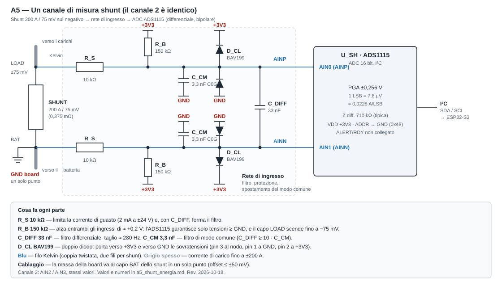

# Schematico A5 — Misura dei due shunt energetici (specifica di disegno)

Requisiti: REQ-IF-005 (Confirmed; precisione 1 % e risoluzione 0,1 A ancora **Assumed**, OPEN-06). Componenti: ADS1115, BAV199, R/C della rete di ingresso (vedi [`../components.md`](../components.md), sezione A5). Stato: **rev. 2026-10-18, R_S = 10 kΩ / R_B = 150 kΩ (scelta utente, decisa il 2026-10-17 come 10 k/143 k; il 143 k non è in stock su LCSC e si è passati a 150 k); simulata con ngspice (sezione in fondo, [`../sim/a5_shunt/`](../sim/a5_shunt/)). Foglio EasyEDA non ancora disegnato**: il server MCP `easyeda-pro` non si è connesso in questa sessione, quindi lo schema è dato come netlist qui sotto, da riportare sul foglio.

Prescrizione di cablaggio (IF-005, Confirmed 2026-10-17): la massa della board è collegata al **lato batteria dello shunt in un solo punto**, con conduttore dedicato; obiettivo di offset di massa ≤ ±50 mV (da misurare).

## Ingressi (per canale; due canali: AIN0-AIN1 e AIN2-AIN3)



Schema leggibile: [`a5_shunt_energia.svg`](a5_shunt_energia.svg). La versione a testo qui sotto è la stessa topologia.

```
shunt, lato batteria (= GND board) ─ Kelvin ─ R_S 10k ─┬─ AINN ── D_CL (BAV199: pin3 al nodo, pin1 a GND, pin2 a +3V3)
                                                        R_B 150k ── +3V3
shunt, lato carichi             ─ Kelvin ─ R_S 10k ─┬─ AINP ── D_CL (idem)
                                                        R_B 150k ── +3V3
C_DIFF 33 nF fra AINP e AINN; C_CM 3,3 nF (C0G) da ciascun ingresso a GND
```

R_B porta gli ingressi circa 0,2 V sopra massa: il datasheet garantisce solo tensioni ≥ GND (§9.2), e un ingresso a −75 mV ne sarebbe fuori. Guadagno circa 0,91; R_S/R_B piccolo mantiene la reiezione di modo comune.

## Numeri (simulati; tra parentesi il calcolo a mano)

| Grandezza | Valore | Nota |
|---|---|---|
| Spostamento di modo comune | +0,206 V | 3,3 V · R_S/(R_S+R_B) |
| Guadagno rete | 0,913 (0,9375 partitore × 0,974 carico 710 kΩ) | 75 mV → 68,5 mV all'ADC; da calibrare in firmware |
| Risoluzione | 0,0228 A/LSB | PGA ±0,256 V; richiesto ≤ 0,1 A |
| Fondo scala | ≈ 690 A | il sovraccarico oltre 200 A si vede |
| Ingresso più basso | +0,137 V a −200 A, offset di massa 0 | tiene fino a circa −0,145 V di offset di massa |
| Filtro differenziale | 282 Hz | R diff 18,75 kΩ, C_DIFF 33 nF + C_CM/2 |
| Rapporto C_DIFF / C_CM | 10 | per non convertire modo comune in differenziale |
| Corrente di bias | 21 µA per ingresso | trascurabile sui fili Kelvin (0,05 Ω di sbilanciamento → 1 µV) |
| Guasto ±24 V su un ingresso | +2,0 mA / −2,3 mA | margine ≈ 4 volte sui 10 mA continui di datasheet |
| Rumore termico delle R (60 °C) | 0,39 µV rms | contro 7,8 µV di LSB: trascurabile |
| Offset ADC (max, **a ±2,048 V**) | ±187,5 µV = ±0,55 A | non specificato a ±0,256 V: **taratura dello zero obbligatoria**; deriva stimata ≈ 0,03 A su 35 °C |
| Deriva guadagno ADC | 7 ppm/°C typ | ≈ 0,025 % su 35 °C |
| Perdita dei clamp sul nodo da 9,4 kΩ (R_S‖R_B) | 5 nA garantiti a 75 V, 25 °C; ≈ 1 nA tipico a 60 °C (grafico) | 1 nA → 9 µV → 0,03 A; 5 nA → 47 µV → 0,14 A di disuguaglianza fra i due lati (statica, assorbita dalla taratura; la deriva con la temperatura **non** è modellata) |

Data rate consigliato 64 SPS (rumore 1 LSB); con due canali alternati una lettura completa ogni ≈ 35 ms. Dopo ogni cambio di MUX scartare la prima conversione (latenza non verificata).

## Distinta (per i due canali) — tutti **Proposto**

| Rif. | Valore / P/N | Qtà | LCSC (istantanea 2026-10-18, fonte debole) |
|---|---|---|---|
| U_SH | ADS1115IDGSR, VSSOP-10 | 1 | C37593 (istantanea 2026-10-17) |
| R_S | Yageo RT0805BRD0710KL, 10 kΩ ±0,1 % 25 ppm | 4 | C110775, circa 672.000 pz |
| R_B | Yageo RT0805BRD07150KL, 150 kΩ ±0,1 % 25 ppm | 4 | C136927, circa 57.000 pz (il 143 k, C865192, ha stock 0) |
| D_CL | Nexperia BAV199,215, SOT-23 | 4 | C40919 (istantanea 2026-10-17) |
| C_DIFF | Yageo CC0805JRX7R8BB333, 33 nF X7R 25 V **±5 %** | 2 | C520038, circa 2.500 pz (poco stock: gli altri 33 nF 0805 X7R trovati sono a 0) |
| C_CM | Murata GRM2165C1H332JA01D, 3,3 nF C0G 50 V **±5 %** | 4 | C77062, circa 44.800 pz (le versioni ±1 % hanno stock 0) |

## Rischi e punti aperti

- Datasheet **Nexperia BAV199 non letto** (403): le tabelle di perdita vengono da Diodes DS30232 e onsemi BAV199L (due costruttori concordano su 5 nA / 75 V / 25 °C e 80 nA / 150 °C). Nessun matching dichiarato fra i due diodi del package; il valore a 60 °C è un tipico da grafico, non garantito. Rileggere il PDF Nexperia prima di congelare.
- Offset e guadagno dell'ADS1115 a ±0,256 V non sono in datasheet: misurare al banco con shunt in corto e con corrente nota. Il carico dell'ingresso (710 kΩ, tipico, senza coefficiente di temperatura) pesa 2,6 % del guadagno: la sua deriva termica è un termine non noto, circa tre volte maggiore che con R_S 3,3 kΩ.
- **C_CM ±5 %** (le ±1 % non sono in stock): la conversione modo comune → differenziale peggiora circa 5 volte rispetto alla simulazione (che usava ±1 %): stima −47 dB a 1 kHz invece di −61 dB. **Non simulato.** Se serve, scegliere ±1 % o accoppiare i C_CM dello stesso canale.
- Il guasto ±24 V riduce la corrente a 2 mA ma **non porta il nodo dentro i limiti assoluti dell'ADS1115** (+3,91 V contro 3,6 V; −0,59 V contro −0,3 V): lo fissa il diodo di clamp. La tenuta è affidata alla corrente (±10 mA continui, §5.1); il datasheet avverte di danno oltre ~300 mV fuori dai binari per tempi prolungati. Un clamp Schottky terrebbe i limiti ma con perdite di µA (peggio per l'offset).
- La corrente di guasto verso il rail (2 mA) va assorbita dal rail 3,3 V: il carico normale della board basta (da confermare nel bilancio del rail).
- Lo stock LCSC di tutte le parti va ricontrollato all'ordine; C_DIFF in particolare ha poco stock.
- Il secondo shunt: se il suo capo lato batteria non sta sullo stesso nodo di negativo batteria, vede un offset proprio (ipotesi annotata in IF-005).
- Cavi Kelvin: coppia twistata, lontana dai cavi da 200 A dell'inverter (OPEN-06, lunghezza da definire).
- Bus I²C: indirizzo 0x48 (ADDR a GND). Il livello acque chiare (A4) usa l'INA219 a 0x40; pin dell'ESP32-S3 non assegnati.
- ALERT/RDY non usato: trattamento da datasheet non verificato (open-drain, comparatore disattivato per default).

## Netlist (designatori provvisori, da allineare al foglio EasyEDA)

Canale 1 = ingressi AIN0 (AINP) / AIN1 (AINN); canale 2 = AIN2 (AINP) / AIN3 (AINN). Il canale 2 è identico, con i designatori `…2…`. Net verso il campo: `SHn_BAT` (capo lato batteria dello shunt n, filo Kelvin) e `SHn_LOAD` (capo lato carichi).

| Net | Pin collegati (canale 1) |
|---|---|
| `SH1_BAT` | connettore Kelvin, polo batteria — R_S1N.1 |
| `SH1_LOAD` | connettore Kelvin, polo carichi — R_S1P.1 |
| `AIN1_N` (AINN) | R_S1N.2 — R_B1N.1 — C_D1.2 — C_C1N.1 — D_CL1N.3 — U_SH.AIN1 |
| `AIN0_P` (AINP) | R_S1P.2 — R_B1P.1 — C_D1.1 — C_C1P.1 — D_CL1P.3 — U_SH.AIN0 |
| `+3V3` | R_B1N.2 — R_B1P.2 — D_CL1N.2 — D_CL1P.2 — U_SH.VDD (+ 100 nF di bypass vicino al pin) |
| `GND` | C_C1N.2 — C_C1P.2 — D_CL1N.1 — D_CL1P.1 — U_SH.GND — U_SH.ADDR (indirizzo 0x48) |
| `I2C_SDA`, `I2C_SCL` | U_SH.SDA, U_SH.SCL (pull-up sul bus, pin ESP32-S3 da assegnare) |
| `ADS_ALERT` | U_SH.ALERT/RDY, non collegato |

Per BAV199: pin 3 al nodo d'ingresso, pin 1 a GND, pin 2 a +3V3. Pinout VSSOP-10 dell'ADS1115 da controllare sul simbolo (non verificato). Un bypass da 100 nF su VDD (non in distinta sopra) è prassi del datasheet, da confermare.

## Esiti della simulazione (ngspice, 2026-10-18, variante adottata `A5_VARIANT=10k150`)

Script `elettrica/sim/a5_shunt/sim_a5.py`, risultati in `out_10k150/results.json` e tre PNG. **Modelli generici, non dei costruttori**: diodo tipo 1N4148 per BAV199 e per i diodi ESD interni dell'ADS1115; l'ADC è solo un carico (710 kΩ differenziale, 100 MΩ di modo comune); perdite dei clamp iniettate come 0–5 nA; nessun rumore dell'ADC, nessuna temperatura, rail 3,3 V ideale. Offset e guadagno propri dell'ADS1115 **non** sono nel modello.

| Prova | Esito |
|---|---|
| Nominale, offset di massa 0 | Guadagno rete 0,913; 68,5 mV all'ADC a 200 A; 0,0228 A/LSB; nodo più basso +0,137 V (a −200 A) |
| Offset di massa, rete nominale, dopo taratura a offset 0 | ≤ 0,0006 A a ±50 mV; ≤ 0,011 A a −150 mV. A −150 mV il nodo scende a −3,8 mV: **limite del campo utile ≈ −0,145 V** |
| Monte Carlo (300): R 0,1 %, C_CM ±1 %, C_DIFF ±10 %, Kelvin 0,03–0,07 Ω, Z diff ADC ±20 %, perdite 0–5 nA | Con offset di massa ±50 mV e taratura a 0: errore **massimo 0,028 A, p95 0,018 A** (a ±10 A e a 200 A) — contro i 0,1 A (1 % a 10 A) richiesti. Lo domina il rapporto R_S/R_B |
| AC differenziale | −3 dB a 282 Hz; −0,17 dB a 50 Hz; −12 dB a 1 kHz; −32 dB a 10 kHz |
| AC modo comune → differenziale (C_CM ±1 % opposti, R_S ±0,1 % opposti) | −73 dB a 50 Hz, −61 dB a 1 kHz, −67 dB a 10 kHz: **la rete limita la reiezione ben sotto i 105 dB tipici dell'ADC** (con C_CM ±5 % circa 14 dB peggio: stima) |
| Guasto +24 V sul capo lato carichi | 2,0 mA in R_S2; nodo AINP a 3,91 V; 2,0 mA scaricati nel rail 3,3 V |
| Guasto −24 V | 2,3 mA in R_S2; nodo AINP a −0,59 V |

Cosa significa:
- La catena soddisfa la risoluzione e, nel modello, l'errore dovuto alla rete (≤ 0,03 A); il budget reale sarà dominato da offset/guadagno dell'ADS1115 a ±0,256 V (non specificati) e dallo shunt.
- Il modo comune a 50 Hz e oltre è attenuato di soli ~70 dB dalla rete: con cavi Kelvin lunghi vicino all'inverter conviene la coppia twistata.

### Confronto con la prima versione (R_S 3,3 kΩ / R_B 47 kΩ / C_DIFF 100 nF / C_CM 10 nF)

| Grandezza | 3,3 k / 47 k | 10 k / 150 k (adottata) |
|---|---|---|
| Guadagno rete | 0,926 | 0,913 (carico dell'ADC 2,6 % contro 0,9 %) |
| Risoluzione | 0,0225 A/LSB | 0,0228 A/LSB |
| Taglio differenziale | 251 Hz | 282 Hz |
| Rumore termico delle R (60 °C) | circa 0,2 µV rms (stima) | 0,39 µV rms |
| Errore Monte Carlo (±50 mV di massa) | max 0,029 A, p95 0,018 A | max 0,028 A, p95 0,018 A |
| Guasto +24 V: corrente / nodo | 6,1 mA / 3,96 V | 2,0 mA / 3,91 V |
| Guasto −24 V: corrente / nodo | 7,1 mA / −0,64 V | 2,3 mA / −0,59 V |

La tensione sul nodo sotto guasto non migliora (la fissa il diodo di clamp); scende la corrente, che è ciò da cui dipende la tenuta secondo il datasheet.

## Verifica del foglio EasyEDA "Current Shunt Sense" (da screenshot, 2026-10-18)

Il server `easyeda-pro` non era disponibile: la verifica è fatta a occhio su uno screenshot fornito dall'utente, **non** su una netlist esportata né con ERC. Il file di progetto (`hardware/caravantic.eprj2`) contiene il foglio, ma i dati sono cifrati e non li ho letti.

Designatori reali: canale 1 (P4 "LV current") R41, R42 (10 kΩ), R43, R44 (150 kΩ), C9, C10 (3,3 nF), C11 (33 nF), U9, U10 (BAV199); canale 2 (P5 "HV current") R45, R46, R47, R48, C12, C13, C14, U12, U13; U11 = ADS1115IDGSR. Nel canale 1 R43 e C9 stanno sulla riga di R41 (AIN0), R44 e C10 sulla riga di R42 (AIN1); U9 sul nodo AIN0, U10 sul nodo AIN1. Il canale 2 ha lo stesso schema.

| Voce | Esito |
|---|---|
| Valori R e C | Conformi (10 kΩ, 150 kΩ, 33 nF, 3,3 nF) |
| Topologia R_S, R_B, C_CM, C_DIFF | Conforme, ma R_B e C_CM stanno su fili verticali che **incrociano l'altra riga senza giunzione**: ambiguo a vista, da confermare con ERC o netlist |
| Pinout U11 sul simbolo | 1 ADDR, 2 ALERT/RDY, 3 GND, 4 AIN0, 5 AIN1, 6 AIN2, 7 AIN3, 8 VDD, 9 SDA, 10 SCL: **coincide con quello assunto**; ADDR a GND (0x48), ALERT/RDY con simbolo di non connesso, VDD a +3V3, SDA/SCL su porte |
| Clamp U9/U10 verso +3V3 | U9 (pin 2) → +3V3 e U10 (pin 1) → GND sono chiari; **gli altri due pin (U9 pin 1, U10 pin 2) passano per due anelli annidati a destra che non riesco a leggere**: attesi U9.1 → GND e U10.2 → +3V3. Se U9.1 fosse unito a U10.2 oppure +3V3 a GND, i clamp sarebbero sbagliati |
| Polarità del canale 2 | **Invertita rispetto al canale 1** nello screenshot: P4 pin 2 → AIN0 (positivo) e pin 1 → AIN1; P5 pin 2 → AIN3 e pin 1 → AIN2. **Da correggere sul foglio a cura dell'utente** (decisione 2026-10-18; nel secondo screenshot la polarità del canale 2 non è leggibile con certezza: da confermare con Highlight Net, P5 pin 2 deve evidenziare AIN2): il positivo di P5 va sul pin 2, come P4, cioè pin 2 → AIN2 e pin 1 → AIN3 |
| Ruolo dei pin dei connettori | Stabilito il 2026-10-18 (vedi sotto): pin 2 = LOAD (AINP), pin 1 = BAT (AINN) |
| Condensatore di bypass su VDD | **Aggiunto**: C15 100 nF fra +3V3 e GND (screenshot successivo, 2026-10-18); ADDR a GND confermato (0x48) |
| Pull-up I²C | Non su questo foglio (da verificare sul foglio MCU) |

### Convenzione dei connettori P4 e P5 (decisa il 2026-10-18)

| Pin | Net | Ruolo | Ingresso ADS1115 |
|---|---|---|---|
| P4 pin 2 | LV current | **LOAD** — capo dello shunt lato carichi (−75…+75 mV rispetto a GND) | AIN0 (AINP) |
| P4 pin 1 | LV current | **BAT** — capo dello shunt lato batteria (= GND board) | AIN1 (AINN) |
| P5 pin 2 | HV current | **LOAD** | AIN2 (AINP) dopo la correzione |
| P5 pin 1 | HV current | **BAT** | AIN3 (AINN) dopo la correzione |

Con questa convenzione corrente positiva (verso i carichi, nello shunt sul negativo) dà lettura positiva su entrambi i canali e in ESPHome bastano i multiplexer `A0_A1` e `A2_A3` senza moltiplicatore negativo. Il segno reale (carica o scarica) va confermato al banco con una corrente nota.

### Come ricontrollare i clamp con l'ERC di EasyEDA Pro

1. Nel foglio, menu **Design → Check ERC** (o l'icona ERC nella barra superiore); fai girare il controllo su tutto lo schematico.
2. Nel pannello risultati, cerca errori su `+3V3` e `GND`: un cortocircuito fra rail compare come "net con più pin di alimentazione" o simile. Se i due anelli a destra di U9/U10 univano `+3V3` e `GND`, qui verrebbe segnalato.
3. Per un controllo diretto della connettività: seleziona un pin e usa **Highlight Net** (evidenzia rete). Verifica che:
   - U9 pin 3 e U10 pin 3 evidenzino rispettivamente le reti di AIN0 e AIN1 (non la stessa);
   - **U9 pin 1 evidenzi GND**, **U9 pin 2 evidenzi +3V3**;
   - **U10 pin 1 evidenzi GND**, **U10 pin 2 evidenzi +3V3**;
   - lo stesso per U12 e U13 (U12 sul nodo AIN2 dopo la correzione, U13 sul nodo AIN3).
4. Anche i fili che si incrociano senza giunzione (R43/C9, R44/C10 e analoghi) si controllano con Highlight Net: R43 e C9 devono evidenziare la stessa rete di AIN0, R44 e C10 quella di AIN1.
5. Opzionale: esporta la netlist (**Export → Netlist**) e passamela, così la confronto con questa specifica.

La stessa verifica va rifatta dopo la correzione del canale 2: cambiano le righe che vanno ad AIN2 e AIN3.
