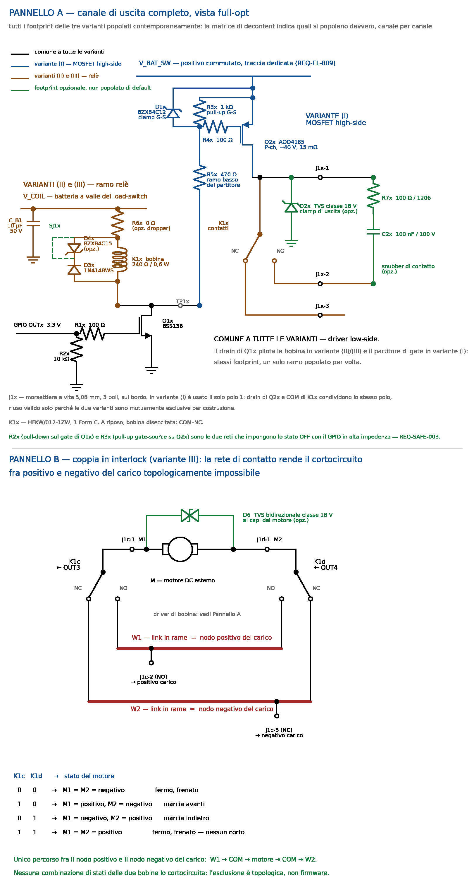

# 04b — Canale di uscita: schematico full-opt e decontent

Schematico **full-opt del canale di uscita completo** — variante (I) MOSFET high-side e variante (II) a relè sullo stesso canale — matrice di decontent e razionali delle scelte.

Estende [`04-outputs.md`](04-outputs.md) portandolo dal livello «topologia» al livello «componenti e valori». Le prescrizioni di quel documento restano valide; qui si aggiungono i dimensionamenti, i part number e i punti in cui la verifica a datasheet ha spostato una scelta.

> **Revisione B — 2026-08-01 (decisioni utente).** Quattro modifiche strutturali rispetto alla rev. A:
>
> 1. **Il relè di canale è il TE Axicom IM06 (2-1462037-3 / IM06TS)** al posto dell'Hongfa HFKW/012-1ZW; il limite della variante (II) scende da 10 A a **2 A** (REQ-IF-008 rev.).
> 2. **Carichi oltre 2 A e motori DC sono demandati a relè esterni** comandati dalla scheda; la **variante (III) a interlock on-board decade** e l'inversione passa al cablaggio esterno (REQ-IF-009 rev., §3.6).
> 3. **Range operativo 10–16 V** (REQ-EL-001 rev.): il pick-up a 9 V non è più un requisito.
> 4. L'**economizzatore PWM di bobina è eliminato**: con la bobina IM la finestra 10–16 V chiude per datasheet (§3.9).
>
> Le sezioni §3.6–3.7 e §3.13 della rev. A sono decadute e conservate come nota storica sintetica; lo schematico in figura è della rev. A e va aggiornato (Pannello B non più applicabile, relè e valori di bobina da sostituire nel Pannello A).

**Traceability:** REQ-IF-008, IF-009, SAFE-002, SAFE-003, EL-001, EL-004, EL-005, EL-009, EL-010, ENV-001, MECH-001, MECH-003, LIFE-001, DIAG-001.

---

## 1. Schematico full-opt

**Pannello A** — un canale con **tutti** i footprint delle varianti popolati contemporaneamente. Non è una configurazione di assemblaggio reale: è la vista da cui la matrice di §2 ricava, per depopolazione, ogni variante. I colori distinguono i blocchi: nero = comune, blu = variante (I), marrone = variante (II), verde = footprint opzionale. *(Figura rev. A: mostra ancora HFKW, D4x/SJ1x e R6x — da aggiornare.)*

**Pannello B** — *decaduto in rev. B*: la rete di inversione non è più on-board (§3.6). Il disegno resta il riferimento per lo **schema di cablaggio esterno** richiesto da REQ-IF-009/SAFE-002, sostituendo ai contatti on-board quelli dei relè esterni.

### 1.1 Sigle e valori

**Comune a tutte le varianti — driver logico low-side**

| Rif | Valore / P/N | Ruolo |
|---|---|---|
| **R1x** | 100 Ω (0805) | Resistore serie di gate di Q1x |
| **R2x** | 10 kΩ (0805) | **Pull-down di gate di Q1x — stato sicuro passivo** |
| **Q1x** | BSS138 (SOT-23) | N-MOSFET low-side. Pilota la bobina in (II) **e** il partitore di gate in (I) |
| **J1x** | morsettiera a vite 5,08 mm, 3 poli | 1 = uscita MOSFET / COM relè, 2 = NO, 3 = NC |

**Variante (I) — MOSFET high-side**

| Rif | Valore / P/N | Ruolo |
|---|---|---|
| **Q2x** | AOD4185 (TO-252) | P-MOSFET, −40 V, R_DS(on) 15 mΩ @ V_GS = −10 V |
| **R3x** | 1 kΩ (0805) | **Pull-up gate-source — stato sicuro passivo** e ramo alto del partitore |
| **R4x** | 100 Ω (0805) | Resistore serie di gate di Q2x, smorzamento |
| **R5x** | 470 Ω (0805) | Ramo basso del partitore, verso il drain di Q1x |
| **D1x** | BZX84C12 (SOT-23) | **Clamp gate-source — non opzionale** |
| **D2x** | **SMBJ18A** (SMB), catodo sull'uscita, anodo su massa di potenza | Clamp di uscita e ricircolo dell'escursione negativa (§3.5) — **si popola solo in variante (I)**: sul COM della variante (II) annullerebbe l'isolamento. Nello schematico congelato è **D13** |

**Variante (II) — relè**

| Rif | Valore / P/N | Ruolo |
|---|---|---|
| **C_B1** | 10 µF / 50 V | Bulk sul rail bobine, **uno per scheda**, non per canale |
| **K1x** | TE Axicom **IM06TS** (2-1462037-7, THT) — SMD: IM06GR (2-1462037-3) | Relè 2 Form C (DPDT), bobina 12 V, 1029 Ω / 140 mW, **polarizzata** |
| **D3x** | 1N4148WS (SOD-323) | Diodo di ricircolo bobina |
| **R7x / C2x** | 100 Ω 1206 / 100 nF 100 V | Snubber RC ai capi del contatto, opzionale su carichi induttivi DC |

`x` è l'indice di canale (a, b, c, d).

*Rimossi in rev. B:* **R6x** (dropper di bobina — inutile con la finestra IM, §3.9), **D4x/SJ1x** (zener di accelerazione del rilascio — il rilascio IM con diodo in parallelo è ≤ 5 ms da datasheet, §3.11), **W1/W2/D6** (rete di inversione — demandata al cablaggio esterno, §3.6).

**Due rail distinti.** Il source di Q2x sta su **V_BAT_SW**, positivo commutato su traccia dedicata (REQ-EL-009), preso **a monte** del load-switch. Due ragioni, nell'ordine:

1. **Il ramo MOSFET non ha nulla da sezionare.** Con Q1x interdetto non esiste percorso fra V_BAT_SW e massa attraverso R3x/R5x: a uscita spenta il ramo assorbe solo leakage. REQ-EL-004 impone il load-switch alle sezioni il cui consumo **non è governabile da un GPIO** — questa non lo è, quindi il load-switch non serve e non peserebbe comunque su REQ-EL-005.
2. **Il load-switch dovrebbe portare la somma delle correnti di carico** — 8 A con i 2 A di requisito, 20 A se si esercita la riserva di incremento — a fronte di zero beneficio energetico.

Le bobine stanno invece su **V_COIL**, dietro load-switch, come richiede REQ-EL-004: quelle sì consumano finché sono eccitate. I due rail non sono lo stesso nodo e non vanno uniti.

---

## 2. Matrice di decontent

Colonne = configurazione del **singolo canale**, scelta in assemblaggio.

| Rif | (I) MOSFET high-side | (II) Relè indipendente |
|---|---|---|
| **R1x** | 100 Ω | 100 Ω |
| **R2x** | 10 kΩ | 10 kΩ |
| **Q1x** | BSS138 | BSS138 |
| **Q2x** | AOD4185 | **NO** |
| **R3x** | 1 kΩ | NO |
| **R4x** | 100 Ω | NO |
| **R5x** | 470 Ω | NO |
| **D1x** | BZX84C12 | NO |
| **D2x/D13** | SMBJ18A — **opzionale** *(decisione utente 2026-08-02)*. **Vincolo:** su un canale che comanda un carico induttivo (bobina di relè esterno) senza D13, il **ricircolo esterno ai capi della bobina è obbligatorio**, non solo prescritto: senza né l'uno né l'altro il kick di spegnimento porta il drain oltre i −40 V di V_DS dell'AOD4185 | **NO** — annullerebbe l'isolamento del contatto |
| **C_B1** | non necessario | popolato *(uno per scheda)* |
| **K1x** | **NO** | IM06TS |
| **D3x** | NO | 1N4148WS |
| **R7x / C2x** | NO | **non previsto nello schematico congelato** *(rinuncia 2026-08-02: sui carichi induttivi in variante II la soppressione è il ricircolo esterno prescritto ai capi della bobina; se una misura in banco mostrasse erosione del contatto, il footprint va reintrodotto con un re-spin)* |
| **TP1x** | **non previsto nello schematico congelato** *(rinuncia: il nodo di drain resta sondabile sui reofori di R25/D12)* | idem |
| **J1x** | 3 poli, usato **solo il polo 1** (uscita) | 3 poli: COM / NO / NC — **polo 1 del solo primo scambio** |

**Mutua esclusione — vincolo elettrico, non solo di BOM.** I due frontend non devono mai essere popolati insieme: oltre al conflitto su J1x-1, con Q1x interdetto la bobina tirerebbe il drain al rail bobine e il partitore R3x/R5x vedrebbe V_BAT_SW − V_COIL, cioè a 14,4 V di carica una V_GS ≈ −1,6 V su Q2x — nell'intorno della soglia — più una corrente permanente di ~1 mA fra i due rail attraverso R3x+R5x e la bobina. La separazione dei rail di §1.1 esiste **solo per depopolazione**.

**Note di lettura.**

- **Il blocco comune non si depopola mai.** R1x, R2x e Q1x (nello schematico congelato: R22, R21, Q1) sono identici nelle due varianti, insieme a CN2: è il risultato più utile di questa vista di canale, e il razionale è in §3.1.
- **Riuso di footprint fra varianti — due casi validi, entrambi verificati.** Il blocco driver (sopra) e il polo **J1x-1**, usato come uscita del P-MOSFET in variante (I) e come COM del relè in (II). Il riuso di J1x-1 è valido **solo** perché le varianti sono mutuamente esclusive per costruzione (vedi sopra il vincolo elettrico).
- **R2x e R3x hanno lo stesso ruolo logico ma non possono condividere una posizione**: il primo va verso PGND, il secondo verso il source di Q2x, cioè verso battery+. Due componenti distinti su due nodi distinti, anche se le aree sono adiacenti.
- I poli J1x-2 e J1x-3 restano **fisicamente presenti e non collegati** in variante (I). È il prezzo del canale identico, non uno spreco evitabile.
- **Il secondo scambio dell'IM06 resta non connesso.** Non va parallelato al primo per «aumentare la portata»: il parallelo di contatti non incrementa il rating di commutazione (§3.8). Un eventuale uso come ridondanza o come ritorno di stato è una modifica da valutare a parte.

---

## 3. Razionali

### 3.1 Il driver low-side è comune alle tre varianti

**Constatazione.** Il MOSFET high-side e il relè hanno bisogno esattamente della stessa cosa dal lato logico: un interruttore low-side comandato da un GPIO a 3,3 V, con pull-down di gate per lo stato sicuro. Cambia solo cosa il drain tira verso massa — la bobina di K1x in variante (II), il ramo basso del partitore di gate di Q2x in variante (I).

**Conseguenza.** R1x, R2x e Q1x sono **una sola terna di footprint, sempre popolata**, con il drain instradato verso entrambi i rami. Non è un riuso opportunistico: è la stessa funzione.

**Verifica elettrica del riuso — fatta, non assunta.** Il nodo di drain è il punto in cui i due rami si incontrano, quindi va dimensionato sul caso peggiore fra i due:

| | Variante (I) | Variante (II) |
|---|---|---|
| Tensione sul drain con Q1x interdetto | V_BAT_SW = 16 V; in transitorio clampato, limitata da D1x a V_S − 12 ≈ 26 V | V_COIL + V_F ≈ 16 + 0,7 = **16,7 V** (solo D3x, rev. B) |
| Corrente da assorbire con Q1x in conduzione | 10,9 mA (partitore, a 16 V) | **15,5 mA** (bobina IM06 a 16 V) |

Il BSS138 (**V_DS 50 V, I_D 0,22 A**) copre entrambe le colonne con margine ampio — in rev. B il caso peggiore di tensione è tornato quello della variante (I). È questo confronto — non l'analogia fra i due circuiti — che rende il riuso legittimo.

**Stato sicuro.** R2x impone lo spegnimento in entrambe le varianti: con il GPIO in alta impedenza, Q1x è interdetto, quindi la bobina è diseccitata e il partitore di gate è aperto, il che lascia R3x libero di tirare il gate di Q2x al source. Due reti in cascata, entrambe passive — REQ-SAFE-003 è soddisfatto senza firmware in tutte le configurazioni.

### 3.2 Il partitore di gate va dimensionato sulla velocità, non solo sulla V_GS

Questo è il punto in cui la prescrizione di [`04-outputs.md`](04-outputs.md) §2.4 — *«resistore di gate scelto per rallentare i fronti»* — va quantificata, perché presa alla lettera porta fuori strada.

**Il rapporto del partitore fissa la V_GS.** Con R3x = 1 kΩ e R5x = 470 Ω:

V_GS = −V_BAT × R3x / (R3x + R5x) = −0,68 · V_BAT

| V_BAT | V_GS | Nota |
|---|---|---|
| 10 V (floor, REQ-EL-001 rev.) | −6,8 V | pieno pilotaggio: R_DS(on) fra i 15 mΩ @ −10 V e i 20 mΩ @ −4,5 V di datasheet |
| 12,8 V | −8,7 V | punto nominale |
| 16 V | −10,9 V | entro il ±20 V di V_GS(max) |
| 38 V (transitorio clampato, REQ-EL-010) | −25,8 V **senza clamp** | oltre il limite assoluto → **D1x non è opzionale** |

**I valori assoluti fissano la velocità, e qui sta il problema.** Con lo stesso rapporto si può scegliere qualsiasi coppia di valori. Il confronto, a 16 V e 2 kHz:

| | R3x = 4,7 kΩ / R5x = 2,2 kΩ | R3x = 1 kΩ / R5x = 470 Ω |
|---|---|---|
| Tempo di spegnimento (attraversamento del plateau, Q_gd = 8,6 nC) | ≈ 13 µs | ≈ 3 µs |
| Tempo di accensione | ≈ 2,4 µs | ≈ 0,6 µs |
| **Perdite di commutazione a 2 A** *(corrente di requisito)* | **≈ 0,51 W** | **≈ 0,12 W** |
| Perdite di conduzione a 2 A | ≈ 0,064 W | ≈ 0,064 W |
| Perdite di commutazione a 5 A *(scenario di incremento, §3.4)* | ≈ 1,3 W | ≈ 0,28 W |
| Perdite di conduzione a 5 A | ≈ 0,43 W | ≈ 0,43 W |
| Corrente nel partitore con uscita ON, a 16 V | 2,3 mA | 10,9 mA |

> **Alla corrente di requisito la commutazione domina, e di parecchio.** A 2 A il partitore lento dissiperebbe **otto volte** quanto dissipa in conduzione, e da solo consumerebbe tutto il budget termico del canale. Il tempo di transizione non è un dettaglio di EMI: è la voce dominante. Rallentare i fronti oltre pochi µs non è una scelta conservativa, è un errore di dimensionamento — e **abbassare la corrente di requisito lo rende più grave, non meno**, perché la conduzione scala col quadrato della corrente mentre la commutazione scala linearmente.

**Criterio proposto, al posto della prescrizione qualitativa:** fissare un tetto alle perdite di commutazione e ricavarne il tempo di transizione ammesso:

t_on + t_off ≤ 2 · P_sw,max / (V · I · f)

Con P_sw,max = 0,5 W nello scenario di incremento (16 V, 5 A, 2 kHz) si ottiene **≤ 6 µs**, che è il vincolo più stringente dei due e va adottato come criterio unico: dimensionare sui soli 2 A chiuderebbe la porta all'incremento di §3.4. I valori proposti stanno a ~3,6 µs, con margine. Il dV/dt risultante è ≈ 5 V/µs, già lento per uno switch di potenza: il contenimento delle emissioni richiesto da REQ-IF-016 non viene sacrificato.

**Costo accettato.** Il partitore veloce assorbe ~11 mA per canale mentre l'uscita è ON, cioè ~0,17 W dissipati nei resistori. È il prezzo di una topologia discreta senza driver di gate dedicato: un vero gate driver non avrebbe questa perdita statica. Non pesa su REQ-EL-005, perché con l'uscita spenta il ramo è aperto e non assorbe nulla.

### 3.3 Selezione del P-MOSFET

**Scelta: AOD4185, TO-252 (DPAK).**

| Parametro | Valore | Perché conta |
|---|---|---|
| V_DS | **−40 V** | Soddisfa REQ-EL-010 esattamente — è il confine, non un margine |
| V_GS | ±20 V | Compatibile con il clamp a 12 V di D1x |
| R_DS(on) | 15 mΩ max @ V_GS = −10 V; **20 mΩ max @ −4,5 V** | Specificato anche a bassa V_GS: è ciò che rende utilizzabile il pilotaggio a −6,8 V al floor di 10 V di batteria |
| Q_gd | 8,6 nC | Determina i tempi di transizione di §3.2 |
| C_iss | 2550 pF | Idem |
| Package | TO-252 / TO-251A | Saldabile a mano, coerente con REQ-LIFE-001 |

**Perché non uno più piccolo, ora che il requisito è 2 A.** A 2 A la conduzione vale 0,064 W: la R_DS(on) è del tutto irrilevante e un componente con 50 mΩ costerebbe appena 0,14 W in più. Due vincoli tengono comunque il DPAK:

1. **V_DS ≥ 40 V** (REQ-EL-010) esclude quasi tutti i P-channel in SOT-23 e la maggior parte di quelli in SO-8, tipicamente a 20–30 V.
2. **Il footprint è l'unica cosa che non si può cambiare dopo.** REQ-IF-008 conserva la riserva di incremento a ~5 A subordinata al piano di rame (§3.4): passare a un package più piccolo la annullerebbe, perché è la capacità termica del package — non il valore di R_DS(on) — a permettere l'incremento. Il DPAK sovradimensionato è quindi una scelta deliberata, non un residuo del requisito precedente.

Resta aperta la verifica se esista un P-channel a −40 V in SO-8 con capacità termica confrontabile: recupererebbe area, ma solo se non compromette il punto 2.

> **Nota su AEC-Q101.** [`04-outputs.md`](04-outputs.md) §2.3 afferma l'esistenza di opzioni automotive AEC-Q101 a bassa R_DS(on) con rating ≥ 40 V. L'AOD4185 **non** è dichiarato AEC-Q101 sul datasheet consultato. Se la qualifica automotive è un requisito, va cercata una parte equivalente qualificata e il costo va riverificato; se non lo è — e per un progetto non certificato (§1 della specifica) ragionevolmente non lo è — la frase di §2.3 va corretta perché induce un'aspettativa non soddisfatta dalla selezione reale.

### 3.4 Bilancio termico della variante (I) — il requisito è 2 A, con riserva di incremento

> **Decisione utente, recepita in REQ-IF-008:** il limite della variante (I) scende da 5 A a **2 A continui per canale**, con **riserva di incremento** subordinata alla possibilità di ricavare in layout un piano di rame di smaltimento sulla faccia opposta. Questa sezione riporta i due scenari con i numeri che li separano.

**Il limite non lo pone il MOSFET, lo pone il rame.** L'AOD4185 è dimensionato per −40 A: a 2 o a 5 A non cambia nulla per il componente. Cambia tutto per la resistenza termica giunzione-ambiente, che dipende dalla superficie di rame collegata alla tab.

**Perdite per canale**, a 16 V e 2 kHz, con transizione di 3,6 µs (§3.2) e R_DS(on) 16 mΩ a freddo:

| I carico | P conduzione | P commutazione | P totale | Tj stimata |
|---|---|---|---|---|
| 1 A | 0,016 W | 0,058 W | 0,07 W | ~51 °C |
| **2 A — requisito** | **0,064 W** | **0,115 W** | **0,18 W** | **~64 °C** |
| 3 A | 0,14 W | 0,17 W | 0,31 W | ~79 °C |
| 5 A | 0,40 W | 0,29 W | 0,69 W → ~0,95 W a caldo | ~155 °C |

*Ipotesi: ambiente interno al contenitore 42 °C (40 °C esterni più ~2 K con 0,72 W totali) e* **RθJA ≈ 120 °C/W** *per la sola piazzola di montaggio.*

> **Il 120 °C/W non è un dato di datasheet.** L'AOD4185 dichiara soltanto RθJC = 2,4 °C/W e RθJA = 88 °C/W su 1 in² di rame 2 oz. Il valore per la piazzola nuda è una stima di letteratura generica: **shall essere sostituito da una misura [B] sul prototipo** prima di considerare chiuso il bilancio. È l'unico numero di questa sezione che non poggia su fonte primaria, ed è quello da cui dipende tutto il resto.

#### Scenario A — requisito 2 A, nessun piano dedicato

Con 0,18 W la RθJA ammessa per restare sotto una giunzione di 130 °C è (130 − 42) / 0,18 ≈ **490 °C/W**: un fattore 4 di margine sulla stima della piazzola nuda. **Nessun piano di smaltimento è necessario.**

Attenzione a non leggerlo come «niente rame»: la pista di drain dimensionata per 2 A è già larga ~1 mm e la piazzola della tab contribuisce. Quel rame è un effetto collaterale del dimensionamento in corrente, non una scelta separata — ed è la maggior parte di ciò che porta la RθJA nell'intorno dei 120 °C/W.

#### Scenario B — riserva di incremento con piano sulla faccia opposta

Con un piano di ~645 mm² sulla faccia opposta collegato alla tab da via termici si punta al valore di datasheet, 88 °C/W. Imponendo Tj ≤ 130 °C e tenendo conto che l'ambiente interno sale con la potenza totale (T_int = 40 + 4·P·2,9):

Tj = 40 + 11,6·P + 88·P ≤ 130 ⇒ P ≤ 0,90 W ⇒ **I ≈ 5,0 A** (con R_DS(on) a caldo ~24 mΩ)

**Il piano vale esattamente il passaggio da 2 A a ~5 A.** Quattro elementi da verificare prima di contarci:

- **I via termici non sono il collo di bottiglia.** Un barile Ø 0,3 mm con placcatura 25 µm su FR-4 da 1,6 mm ha sezione di rame ≈ 2,5·10⁻⁸ m², quindi ≈ **165 K/W**; dodici in parallelo danno **≈ 14 K/W**, trascurabili rispetto ai ~90 K/W del piano verso l'aria.
- **Il piano è al potenziale di drain**, cioè il nodo commutato. Verificato che non è un problema EMI: 645 mm² sopra un piano a 1,6 mm valgono ≈ 15 pF e a 5 V/µs la corrente di spostamento è **77 µA**.
- **Serve un keep-out attorno ai pin di contatto dei relè anche sulla faccia opposta.** L'IM06 dichiara 1800 Vrms fra bobina e contatti: portare un piano a 16 V a ridosso dei pin di contatto vanificherebbe l'isolamento che la variante a relè dovrebbe garantire.
- **Dipende dallo stackup, che oggi è dichiarato fuori ambito.** Su due strati la faccia opposta è il piano di ritorno e il piano di smaltimento non è ricavabile; su quattro non c'è problema. La scelta del numero di strati diventa quindi **propedeutica** e non più rimandabile alla fase di layout.

**Sul dissipatore incollato**, valutato e non adottato come soluzione di prima scelta: la tab del DPAK è il **drain**, quindi quattro canali sono quattro nodi diversi che commutano 0→16 V. Un dissipatore condiviso li cortocircuiterebbe e richiede per forza un interfaccia isolante — che costa poco in termini termici (un pad da 0,25 mm a 1,5 W/mK su 36 mm² aggiunge ≈ 4,6 K/W) ma introduce due problemi peggiori: il dissipatore isolato è un conduttore flottante accoppiato a quattro nodi commutati, da riferire a massa scheda, e l'incollaggio con epossidica termica rende **distruttiva la rilavorazione** su una scheda montata a mano. Se dovesse servire, meglio clip o vite con pad termico. Verificato inoltre che il contenitore non è il collo di bottiglia: ~0,044 m² di superficie con un coefficiente convezione+irraggiamento di 8 W/m²K danno ≈ 2,9 K/W verso l'esterno, e la parete PETG in sé ≈ 0,2 K/W. Il coefficiente di convezione è una stima da manuale, non da fonte primaria.

> **La riserva va esercitata in layout, non dopo.** Tutto il resto di questa sezione è depopolabile: un valore sbagliato si cambia in assemblaggio. **Il rame no.** Se il piano non viene disegnato, alzare la corrente richiede una nuova revisione di scheda. Il layout **shall** quindi tentare di ricavarlo anche restando a 2 A di requisito, e riportare a verbale se non ci riesce.

#### Costo d'area

Stima con assunzioni dichiarate, da confermare in fase di floorplan — non un layout:

| Voce | Scenario A (2 A) | Scenario B (piano per ~5 A) |
|---|---|---|
| 4 × relè IM06, corpo 10 × 6 mm con distanza di montaggio *(rev. B — era 1080 mm² con HFKW)* | ~280 mm² | ~280 mm² |
| 4 × MOSFET: piazzola e pista di drain | 480 mm² | 480 mm² |
| Morsettiere: 12 poli × 5,08 mm = 61 mm di bordo × ~12 mm | 730 mm² | 730 mm² |
| Passivi e driver, ~13 posizioni per canale più routing | 600 mm² | 600 mm² |
| **Totale sulla faccia componenti** | **≈ 2090 mm², ~21%** *(rev. B)* | **≈ 2090 mm², ~21%** |
| Rame termico | — | ≈ 2580 mm² **sulla faccia opposta** |

Lo scenario A porta la sezione uscite dal ~50% della versione a 5 A al **~21%** dei 100 × 100 mm di REQ-MECH-001 (era ~29% con l'HFKW). Lo scenario B non peggiora l'occupazione della faccia componenti, perché il rame sta sull'altra faccia: **è questo il motivo per cui la riserva è realistica**, non un buon proposito.

**Impatto funzionale della riduzione.** I 2 A limitano solo la potenza *dimmerabile*, cioè 24 W per canale a 12 V. I carichi on/off oltre tale soglia passano dal relè esterno comandato dalla scheda (rev. B, §3.6): il limite on-board è 2 A in entrambe le varianti. Resta da confrontare i 24 W con le strisce LED effettivamente installate — dato di impianto che non è in mio possesso (punto aperto 13, §4).

### 3.5 Clamp di uscita D2x

**Ruolo doppio.** Verso l'alto clampa i transitori che rientrano dal cavo di uscita; verso il basso, in conduzione diretta, limita l'escursione negativa dell'uscita allo spegnimento su un carico con induttanza — quella del cavo, se non del carico. Un diodo di ricircolo semplice coprirebbe solo il secondo caso.

**Criterio di selezione, classe da congelare.** V_RWM **superiore ai 16 V**, perché con l'uscita accesa il nodo sta a V_BAT; V_C alla corrente attesa **inferiore ai 40 V** di V_DS di Q2x.

**Proposta congelabile *(rev. B)*: SMBJ18A, unidirezionale, 600 W.** V_RWM 18 V > 16 V (breakdown min 20,0 V: non conduce mai nel range operativo), V_C 29,2 V alla corrente di picco tabulata su 10/1000 µs — ben sotto i 40 V; alle correnti reali di una bobina di relè esterno (~100–150 mA, energia di qualche mJ) il clamp lavora poco sopra i 21 V. **Orientamento: catodo sull'uscita, anodo su PGND.** In diretta (−0,7 V) fa da ricircolo per l'escursione negativa allo spegnimento della bobina esterna — è il «ruolo doppio» descritto sopra — e resta comunque prescritto il diodo di ricircolo ai capi della bobina esterna, che è la soppressione primaria. Stessa famiglia del clamp di ingresso: verifica [D] finale di V_C sul datasheet Bourns/Littelfuse del P/N ordinato, come già fatto per l'ingresso ([`01-power-supply.md`](01-power-supply.md) §1.3). **Resta di sola variante (I):** in variante (II) un TVS verso PGND sul nodo COM annullerebbe l'isolamento galvanico del contatto. **Footprint SMB in comune** con il TVS di ingresso — riuso valido — ma **valore diverso**: non va ereditato. *(Rev. B: D6 non esiste più a bordo; lo stesso criterio di classe vale per il TVS motore esterno prescritto in §3.6.)*

> **Conseguenza sul grounding.** La corrente di ricircolo di D2x rientra sulla **massa di potenza della scheda**, anche se il ritorno nominale del carico è esterno. È un percorso che [`04-outputs.md`](04-outputs.md) §6 non menziona e che va incluso nella separazione star-ground di REQ-EL-009.

### 3.6 Inversione motori DC — demandata al cablaggio dei relè esterni *(rev. B)*

**La variante (III) on-board è decaduta** (decisione utente 2026-08-01): la scheda non commuta motori. La rete di inversione dimostrata nella rev. A — COM di ciascun relè a un morsetto del motore, i due NO uniti sul positivo del carico, i due NC sul negativo — **resta la topologia prescritta**, ma realizzata con **due relè automotive esterni** le cui bobine sono comandate da due canali della scheda. La garanzia topologica (nessun percorso positivo→negativo che non passi per il motore, in nessuno dei quattro stati) è invariata e passa dallo schematico allo **schema di cablaggio di installazione**, che diventa il documento su cui si esegue l'ispezione di REQ-SAFE-002.

Conseguenze già dimostrate in rev. A che restano valide e vanno riportate nella documentazione di installazione: **frenatura dinamica inerente** nei due stati di riposo (ruota libera non ottenibile); **corrente di frenatura attraverso i contatti NC** dei relè esterni, da conteggiare nella loro selezione; **diodo di ricircolo su ciascuna bobina esterna** e **TVS bidirezionale ai capi del motore**; **tempo morto firmware** fra le due direzioni, da congelare sul tempo di rilascio misurato dei relè esterni scelti (indicativamente ≥ 50 ms).

**Cosa guadagna la scheda.** Spariscono i due nodi di potenza a bordo (W1/W2) che in rev. A riducevano l'isolamento della coppia, il dimensionamento in sezione dei link, e l'intero carico termico e d'area dei relè di potenza. Il canale on-board vede solo la bobina del relè esterno: decine–centinaia di mA, carico induttivo in continua con ricircolo esterno prescritto e D2x popolato sul canale (variante I) o snubber/ricircolo sul contatto (variante II).

#### 3.6.1 Secondo schema di installazione — esclusione in cascata per comandi 12 V mutuamente esclusivi *(2026-08-02)*

Per **due utenze indipendenti che non devono mai essere attive insieme** — caso diverso dall'inversione — l'esposizione di COM/NO/NC su CN2 permette l'interblocco in cascata: **NC del canale 1 → COM del canale 2**, alimentazione su COM del canale 1. Con K1 eccitato, NC1 apre e toglie alimentazione ai contatti del canale 2: l'attivazione simultanea *a regime* è impedita in hardware.

**Limiti dichiarati, accettati per questo caso d'uso** (sono i motivi per cui la cascata resta *vietata* come sostituto della rete di inversione sui motori):

1. **Non è robusta al contatto incollato**: la garanzia sta interamente nell'apertura di NC1. La rete di inversione è sicura anche a contatto saldato; la cascata no.
2. **Finestra transitoria di qualche ms**: con comandi quasi simultanei, NO2 può chiudere prima che NC1 apra (operate ≤ 3 ms, bounce ≤ 5 ms). Il firmware **shall** mantenere comunque l'esclusione con tempo morto — la cascata è la rete di sicurezza, non il meccanismo primario.
3. **La corrente del ramo 2 transita per NC1**: si conteggia nel rating di 2 A del canale 1 e ne consuma l'endurance, incluse le aperture sotto carico ogni volta che il canale 1 viene eccitato con il 2 attivo. Nota dal datasheet Rev. M: il rating UL a 30 VDC / 2 A è dichiarato **«NO only»** — sul contatto NC il riferimento resta il solo limiting continuous current IEC di 2 A, da annotare se la certificazione UL avesse rilevanza.

**Selezione dello schema per coppia:** inversione → rete di inversione dei relè esterni (obbligatoria, REQ-IF-009); esclusione di utenze indipendenti → cascata NC→COM, on-board entro 2 A o sui relè esterni per correnti superiori. Entrambi gli schemi sono disegni obbligatori della documentazione di installazione (REQ-SAFE-002).

### 3.8 Selezione del relè — relè signal, non relè di potenza *(rev. B)*

**Scelta: TE Axicom IM06TS** (2-1462037-7, THT; SMD gull-wing IM06GR, 2-1462037-3), 2 Form C, bobina 12 V / 140 mW, sostituisce l'Hongfa HFKW/012-1ZW della rev. A.

**Perché la sostituzione è coerente con il nuovo requisito.** Con il limite di canale a 2 A (REQ-IF-008 rev.) il profilo del carico si ribalta rispetto alla rev. A: non più correnti alte con carico motore, ma utenze leggere e bobine di relè esterni, cioè correnti da mA a un paio di ampere. Su questo profilo l'HFKW era il relè sbagliato — carico minimo di contatto 1 A, sotto il quale l'affidabilità non è caratterizzata — e l'IM è quello giusto:

| | IM06TS/GR | HFKW/012-1ZW (rev. A) |
|---|---|---|
| Contatti | 2 Form C, bifurcati, PdRu dorato | 1 Form C, AgSnO2 |
| Corrente max (continua / commutazione) | **2 A / 2 A**, 60 W max | 35 A NO / 20 A NC |
| Carico minimo | 100 µV / 10 mA (condizione di misura); adatto a segnali | **1 A a 12 VDC** |
| Bobina | 1029 Ω, **140 mW** (12 mA a 12 V) | 240 Ω, **0,6 W** (50 mA) |
| Finestra di bobina | operate ≤ 9,0 V, **U_max continua 28,9 V** a 23 °C | pick-up ≤ 7,3 V, regione continua ferma a ~15 V |
| Operate / release (con diodo) | ≤ 3 ms / ≤ 5 ms | ≤ 10 ms / ≥ 5 ms |
| Ingombro | **10 × 6 × 5,65 mm**, 0,75 g | 15,7 × 12,5 mm, 6 g |
| Endurance dichiarata in DC | 10⁵ op a 30 VDC / 2 A resistivi | curve su carico motore 13,5 VDC |

**Versione: IM06GR (SMD gull-wing), accettata per assemblaggio manuale** *(decisione utente 2026-08-02)*: i terminali gull-wing sono rivolti verso l'esterno del corpo e restano accessibili al saldatore, quindi REQ-LIFE-001 è soddisfatto anche senza la THT (IM06TS resta l'alternativa a footprint diverso). Attenzione in processo: MSL 3 — gestione dell'umidità prima della saldatura da annotare nelle istruzioni di assemblaggio. Range −40…+85 °C, IP67, coerente con REQ-ENV-001.

> **Limiti dichiarati della scelta — sono il perimetro, non difetti.**
>
> - **2 A e 60 W sono il tetto del canale.** Carichi superiori e motori passano dal relè esterno (§3.6). L'IM **non è caratterizzato su carico motore DC**: anche un piccolo motore entro i 2 A di targa spunta oltre il rating di commutazione, quindi il divieto non è negoziabile a valle.
> - **Il parallelo dei due scambi non aumenta la portata.** Nessuna sincronizzazione fra i poli è garantita: in commutazione il primo contatto che chiude e l'ultimo che apre vedono l'intero carico, e in portata la ripartizione dipende dalle resistenze di contatto. È la precauzione standard dei costruttori (Omron, §7; NAVSEA SD-18, §7). Se in futuro servissero più di 2 A a bordo, la via corretta è il P/N **IM06DTS** (3-1462039-8), versione "D" high-current da **5 A** sullo stesso footprint — non il parallelo. Attenzione: il datasheet Rev. M qualifica il dato con *«for 5A applications please contact TE»* — la riserva a 5 A non è quindi esercitabile dal solo datasheet e richiede conferma del costruttore.
> - **La bobina è polarizzata.** L'IM è un relè polarizzato: l'inversione dei terminali di bobina è un errore invisibile a schema e il verso va verificato sul footprint in fase di review (checklist §6).
> - **Endurance a 2 A: 10⁵ operazioni.** Sul carico massimo il numero di cicli è modesto; sulle correnti tipiche del nuovo profilo (mA–centinaia di mA) l'endurance sale di ordini di grandezza. Da confrontare con la frequenza di attuazione reale dell'utenza più commutata.

### 3.9 Finestra di tensione di bobina — chiude sull'inviluppo 10–16 V *(rev. B)*

Il punto critico della rev. A è risolto dalla combinazione di due modifiche: il range operativo rialzato a 10 V (REQ-EL-001 rev.) e la bobina IM06.

**Estremo superiore — chiude per datasheet.** U_max continua della bobina 140 mW è **28,9 V a 23 °C**: i 16 V valgono il 133% del nominale, in piena regione «continuously applicable». La dissipazione a 16 V è 16²/1029 ≈ **0,25 W** per bobina, 1,0 W con quattro bobine eccitate — contro i 4,3 W dell'HFKW. Il caso termico dimensionante del contenitore **non è più il ramo relè**: diventa la variante (I) con riserva di incremento esercitata (~3,8 W a 5 A, §3.4). Resta da leggere sulla curva «coil operating range» il valore derated a +40 °C **[D]** — atteso ampiamente sopra i 16 V.

**Estremo inferiore — chiude, con margine sottile proprio a 10,0 V.** Operate ≤ 9,0 V a 23 °C; scalando con il coefficiente termico del rame (~0,4%/K) ai +40 °C di REQ-ENV-001 si ottiene ≈ **9,6 V**. A 10,0 V di batteria, sottratta la caduta su Q1x (~0,1 V a 10 mA di bobina, §3.10), la bobina vede ≈ **9,9 V**: margine ≈ 0,3 V (~3%) all'estremo esatto del range, che sale rapidamente sopra i 10,5 V. Il pick-up serve solo all'istante di attuazione, non in tenuta (release ≥ 1,2 V), quindi il margine sottile riguarda il solo caso «attuazione a batteria al floor e a 40 °C». **Verifica a banco [B]** dell'attuazione a 10,0 V/40 °C, e annotazione in BOM.

**Economizzatore PWM: eliminato.** Con 0,25 W per bobina al caso peggiore non c'è più nulla da economizzare; la complessità firmware (duty di tenuta, validazione sotto vibrazione) e il punto aperto associato decadono. Decade anche **R6x** (dropper serie) e l'alternativa architetturale della bobina a 5 V.

**Assorbimento sul rail.** 4 × 15,5 mA a 16 V = **62 mA** (50 mA a 12,8 V), da conteggiare nella corrente di hold del PTC (REQ-SAFE-001, [`01-power-supply.md`](01-power-supply.md) §1.1) e nel dimensionamento del load-switch delle bobine — in netto calo rispetto ai 200 mA della rev. A.

### 3.10 Il driver low-side: perché BSS138 e non un MOSFET a bassa R_DS(on)

A 10–15 mA la resistenza di canale conta poco: il parametro che decide è la **V_DS**, per il caso peggiore della tabella di §3.1 — che in rev. B è il transitorio clampato della variante (I), 26 V. Un AO3400A (30 V) resterebbe formalmente dentro ma senza margine: la sua R_DS(on) da qualche decina di mΩ è un vantaggio che qui non serve, il rating a 30 V un limite che qui vincola. Il BSS138 a 50 V resta la scelta.

> **Da annotare in BOM — la caduta sul driver, ridimensionata in rev. B.** La R_DS(on) del BSS138 è specificata **6,0 Ω a V_GS = 4,5 V** (3,5 Ω a 10 V); a 3,3 V di pilotaggio il valore reale è più alto, ~10 Ω da leggere in curva **[D]**. Con la bobina IM06 da ~10 mA la caduta è ≈ **0,1 V** — entra nel margine di pick-up a 10,0 V (§3.9) ma non lo domina più, come invece accadeva con i 50 mA dell'HFKW. In variante (I) la stessa caduta è irrilevante, perché la tensione di drain non entra nel bilancio di gate.

**Vincolo di assegnazione pin.** Nessuna uscita su pin di strapping ([`02-mcu.md`](02-mcu.md) §2.2, vincolo 2). Il pin **shall** essere servito da un timer PWM indipendente: serve alla variante (I) per il dimming. Con l'economizzatore eliminato (§3.9) la variante (II) non ne ha più bisogno, ma il vincolo resta perché il canale è identico e la variante si decide in assemblaggio.

### 3.11 Ricircolo di bobina e velocità di rilascio

**D3x = 1N4148WS.** I_F(AV) 150 mA contro i ~15 mA della bobina IM06, V_R 75 V contro i 16 V del rail: margine ampio su entrambi i parametri. È lo **stesso componente già in BOM** come D1 nello stadio di ingresso ([`03-inputs.md`](03-inputs.md) §6): stesso footprint SOD-323, una riga di BOM in meno, e il riuso è elettricamente valido — verificato, non assunto.

**D4x e SJ1x: eliminati in rev. B.** La rete di accelerazione del rilascio serviva l'inversione di marcia on-board, che è decaduta (§3.6). Per l'IM06 il datasheet dichiara il release time **con diodo in parallelo: ≤ 5 ms** — già misurato nella configurazione reale, senza rete aggiuntiva. Sparisce anche la trappola di orientamento dello zener in antiserie segnalata in rev. A.

### 3.12 Protezione del contatto e connettori

**R7x/C2x — snubber RC ai capi del contatto, non popolato di default.** Serve sui carichi induttivi in continua della variante (II) — inclusa la bobina di un relè esterno, se il ricircolo esterno prescritto non fosse praticabile — dove l'arco all'apertura è il meccanismo dominante di erosione. Non è popolato di default perché su un carico resistivo è inutile e introduce un percorso in alternata che bypassa il contatto.

**Protezioni dell'inversione: esterne.** Diodo di ricircolo su ciascuna bobina di relè esterno e TVS bidirezionale ai capi del motore sono prescritti dalla documentazione di installazione (§3.6), non più popolati a bordo.

**J1x — morsettiera a vite 5,08 mm, 3 poli per canale.** In variante (II) espone COM / NO / NC del primo scambio; la variante (I) usa il solo polo 1. I tre poli restano anche senza la variante (III): il contatto di scambio completo è ciò che rende il canale utilizzabile sia NO sia NC.

> **Conseguenza di layout da verificare.** 4 canali × 3 poli a passo 5,08 mm ≈ **61 mm di bordo**, più i 2 poli dell'alimentazione. Sta nei 100 mm di REQ-MECH-001 su un solo lato, ma con poco spazio residuo: REQ-MECH-003 non fissa il numero di poli delle uscite e va aggiornato con questo dato.

### 3.13 W1 e W2 — decaduti *(rev. B)*

I link in rame della rete di inversione non esistono più a bordo: l'inversione è demandata al cablaggio dei relè esterni (§3.6). Resta valida, come lezione di progetto, la conclusione della rev. A: un ponticello 0 Ω a chip non è mai un sostituto valido per un link di potenza — se un caso analogo si ripresentasse, il rating discende dalla sezione di rame, non da un componente a catalogo. Con l'inversione esterna, la robustezza rispetto al cablaggio dell'installatore **non è più garantita dalla scheda**: dipende dallo schema di cablaggio prescritto, ed è il rischio residuo dichiarato in REQ-SAFE-002 rev.

### 3.14 Rinunce dichiarate

- **Nessuna diagnostica per canale**, né sul MOSFET (open-load, sovratemperatura) né sul relè (ritorno di stato del contatto). Sul relè un sense richiederebbe un partitore permanente su nodi appartenenti all'alimentazione esterna, in contrasto con l'isolamento della variante. La telemetria di DIAG-001 riporta lo **stato comandato**, non quello misurato. Coerente con la rinuncia già dichiarata in [`04-outputs.md`](04-outputs.md) §2.7. *(Nota rev. B: il secondo scambio libero dell'IM06 renderebbe possibile un ritorno di stato del primo a costo quasi nullo — non adottato, resta una rinuncia consapevole.)*
- **Nessuna commutazione di motori o carichi oltre 2 A a bordo** *(rev. B)*: demandata ai relè esterni, con selezione, fusibile e cablaggio come requisiti di installazione.
- **Nessuna protezione da sovracorrente a bordo**, come da [`04-outputs.md`](04-outputs.md) §4.
- **Nessun LED di canale.** I LED stanno sull'I/O expander (REQ-IF-013, REQ-IF-015).

---

## 4. Punti aperti e valori da congelare

| # | Punto | Chi decide | Bloccante per |
|---|---|---|---|
| 1 | ~~Economizzatore PWM oppure bobina 5 V~~ **Chiuso in rev. B: bobina IM06 diretta, economizzatore eliminato** (§3.9) | deciso dall'utente | — |
| 2 | ~~U_max della bobina IM06 derated a +40 °C~~ **Chiuso [D] 2026-08-02** sul datasheet Rev. M fornito dall'utente: a +40 °C anche la curva più restrittiva (U_max @ 2×2 A) resta sopra ~1,8×U_nom ≈ 21,6 V, contro i 16 V richiesti (1,33×U_nom) | — | — |
| 3 | Attuazione del relè a 10,0 V di batteria e 40 °C (margine di pick-up ~3%, §3.9) | misura [B] | acceptance REQ-IF-008 (II) |
| 4 | ~~I 5 A continui sono un requisito reale?~~ **Chiuso: REQ-IF-008 portato a 2 A con riserva di incremento** (§3.4) | deciso dall'utente | — |
| 4a | **RθJA reale del MOSFET con la sola piazzola**, oggi stimata a 120 °C/W da letteratura generica | misura [B] sul prototipo | validità dell'intero bilancio di §3.4 |
| 4b | **Numero di strati del PCB**, oggi fuori ambito: su 2 strati il piano di smaltimento non è ricavabile | utente / layout | esercizio della riserva di incremento |
| 5 | Floorplan preliminare della sezione uscite (stima d'area §3.4 da rifare con IM06: i relè scendono da 1080 a ~280 mm²) e tentativo di ricavare il piano sulla faccia opposta | verifica di layout | congelamento dello schema |
| 6 | Valori definitivi di R3x/R5x, con misura dei tempi di transizione e delle perdite | misura [B] (§3.2) | bilancio termico della variante (I) |
| 7 | Qualifica AEC-Q101 del P-MOSFET: requisito o no (§3.3) | utente | selezione di Q2x, costo |
| 8 | ~~Popolare o no D4x~~ **Chiuso in rev. B: D4x/SJ1x eliminati, release IM06 ≤ 5 ms con diodo** (§3.11) | deciso dall'utente | — |
| 9 | D2x: proposto **SMBJ18A** (§3.5), da chiudere con verifica [D] di V_C sul datasheet del P/N ordinato; classe del TVS motore **esterno** da prescrivere nella documentazione di installazione | verifica [D] | BOM, doc. installazione |
| 10 | ~~W1/W2~~ **Chiuso in rev. B: decaduti** (§3.13) | deciso dall'utente | — |
| 11 | Tempo morto di inversione a firmware, da congelare sul rilascio misurato dei **relè esterni** scelti | misura [B] in installazione | firmware, doc. installazione |
| 12 | R_DS(on) del BSS138 a V_GS = 3,3 V, da includere nel bilancio di bobina | verifica [D] | margine a 10 V |
| 13 | **Censimento dei carichi reali per canale** contro il tetto di 2 A / 60 W, con individuazione di quali utenze richiedono il relè esterno | utente / dati di impianto | assegnazione canali, doc. installazione |
| 14 | Selezione del relè esterno di riferimento (bobina ≤ 2 A — tipicamente ~150 mA — contatti dimensionati sul carico, endurance su carico motore per l'inversione) | utente / doc. installazione | REQ-IF-009 |

## 5. Impatti sugli altri documenti

| Documento | Modifica richiesta |
|---|---|
| specifica di sistema, REQ-EL-001 | ✔ **fatto (rev. B)** — range operativo 10–16 V, banda 9–10 V declassata a «nessun danno» |
| specifica di sistema, REQ-IF-008 | ✔ **fatto (rev. B)** — variante (II) a 2 A con IM, carichi > 2 A e motori via relè esterno |
| specifica di sistema, REQ-IF-009 / SAFE-002 | ✔ **fatto (rev. B)** — inversione demandata al cablaggio dei relè esterni |
| specifica di sistema, REQ-MECH-003 | ✔ **fatto (rev. B)** — nota sul rating morsettiera aggiornata al limite di 2 A |
| [`04-outputs.md`](04-outputs.md) §1, §3, §7, §8 | ✔ **fatto (rev. B)** — due varianti, relè esterno, checklist aggiornata |
| [`04-outputs.md`](04-outputs.md) §2.3 | Correggere l'affermazione sulle opzioni AEC-Q101 ≥ 40 V: la selezione reale non è qualificata automotive (§3.3) |
| [`04-outputs.md`](04-outputs.md) §2.4 | ✔ **fatto** — sostituita la prescrizione qualitativa sul resistore di gate con il criterio quantitativo di §3.2 |
| [`04-outputs.md`](04-outputs.md) §6 | Aggiungere il ricircolo di D2x fra i percorsi che rientrano sulla massa di potenza (§3.5) |
| [`01-power-supply.md`](01-power-supply.md) §1.1 | Conteggiare **62 mA** di bobine (non più 200 mA) nella corrente di hold del PTC; ricontrollare la caduta del PTC al nuovo floor di 10 V |
| **Documentazione di installazione (nuovo deliverable)** | Schema di cablaggio di inversione dei relè esterni (disegno obbligatorio, REQ-SAFE-002), ricircolo sulle bobine esterne, TVS motore, requisito fusibili di ramo |
| specifica di sistema, REQ-MECH-001 | Stima d'area della sezione uscite da rifare con IM06 (~relè da 1080 a ~280 mm²): verificare in floorplan, insieme alla ricavabilità del piano sulla faccia opposta |
| specifica di sistema, §1 «Fuori scopo» | Lo **stackup** non è più rimandabile: il numero di strati condiziona la riserva di incremento di REQ-IF-008 |
| schematico (figura §1) | Aggiornare il Pannello A alla rev. B (IM06, niente D4x/SJ1x/R6x/W1/W2/D6) e rimuovere il Pannello B |

## 6. Checklist di rilascio

**Comune**

- [ ] R2x presente su ogni canale; V_DS di Q1x verificata contro il caso peggiore fra i due rami (26 V in transitorio clampato, variante I — §3.1 rev. B)
- [ ] Nessuna uscita su pin di strapping; pin di canale su timer PWM indipendente
- [ ] J1x-1 condiviso fra uscita MOSFET e COM relè, con nota di mutua esclusione in documentazione di assemblaggio

**Variante (I)**

- [ ] D1x presente su ogni canale MOSFET — verificato che senza clamp la V_GS supera il limite assoluto in transitorio
- [ ] R3x presente su ogni canale MOSFET (stato sicuro)
- [ ] Tempi di transizione misurati e perdite di commutazione entro il tetto di §3.2, valutato **nello scenario di incremento a 5 A** e non solo ai 2 A di requisito
- [ ] **RθJA effettiva misurata [B]** e confrontata con la stima di 120 °C/W; bilancio di §3.4 rifatto sul valore misurato
- [ ] V_DS ≥ 40 V verificata a datasheet; dissipazione a **2 A** / 40 °C verificata sulla RθJA misurata
- [ ] Package a maggiore capacità termica conservato anche se sovradimensionato a 2 A, per non annullare la riserva di incremento
- [ ] Piano di smaltimento sulla faccia opposta: tentato in layout, esito a verbale; se ricavato, keep-out attorno ai pin di contatto dei relè verificato
- [ ] Ricircolo di D2x incluso nella separazione star-ground

**Variante (II)**

- [ ] D3x presente su ogni bobina
- [ ] **Polarità della bobina IM06 verificata sul footprint** — relè polarizzato, errore invisibile a schema (§3.8)
- [ ] Bilancio di tensione di bobina chiuso a 10 V (pick-up a +40 °C, caduta su Q1x inclusa) [B] e a 16 V (U_max derated letta in curva) [D]
- [ ] Secondo scambio non connesso e **non parallelato** al primo; divieto annotato in schematico (§3.8)
- [ ] 62 mA di bobine conteggiati nella corrente di hold del PTC
- [ ] Versione IM06GR (gull-wing) confermata saldabile a mano sul prototipo; MSL 3 gestita nelle istruzioni di assemblaggio; range di immagazzinamento annotato in BOM (REQ-ENV-001)
- [ ] Canali che comandano bobine di relè esterni: D2x popolato (variante I) o snubber/ricircolo previsto (variante II); ricircolo esterno prescritto nella documentazione

**Inversione esterna (REQ-IF-009 / SAFE-002)**

- [ ] Schema di cablaggio di inversione incluso nella documentazione di installazione come disegno obbligatorio
- [ ] Impossibilità topologica del corto verificata per ispezione sui quattro stati, sullo schema di cablaggio esterno
- [ ] Tempo morto di inversione implementato a firmware, congelato sul rilascio misurato dei relè esterni

**Sistema**

- [ ] Dissipazione totale verificata contro il budget termico del contenitore PETG a 40 °C, nel caso peggiore di ciascuna variante — in rev. B il caso dimensionante è la variante (I) con riserva esercitata (~3,8 W), non più le bobine (1,0 W a 16 V)
- [ ] Floorplan della sezione uscite confrontato con la stima d'area di §3.4, rifatta con l'ingombro IM06
- [ ] Numero di strati del PCB deciso: senza, la riserva di incremento di REQ-IF-008 non è valutabile

## 7. Fonti

- TE Connectivity / Axicom, *IM Relay*, datasheet **Rev. M (10-2020)**, fornito dall'utente (LCSC C2841881) — coil data IM06 confermati (1029 Ω, 140 mW, operate 9,00 V, release 1,20 V a 23 °C), polarità bobina **+ su pin 1, − su pin 8**, curva «coil operating range» a +40 °C, UL 30 VDC/2 A «NO only», nota «for 5A applications please contact TE» sulla versione D, MSL 3 con floor life 168 h. Versione precedente consultata online: Rev. K, <https://www.farnell.com/datasheets/477186.pdf>
- Omron, FAQ e precauzioni d'uso relè — il parallelo dei contatti non aumenta la portata; la corrente si concentra sul contatto a resistenza minore: <https://components.omron.com/us-en/faq/relays/FAQE10056>
- NAVSEA, *SD-18 Parts Requirement and Application Guide — Relays* — meccanismo di guasto del parallelo di contatti (skew di apertura/chiusura): <https://www.navsea.navy.mil/Portals/103/Documents/NSWC_Crane/SD-18/PDFs/Products/Archive/Relays/Relays.pdf>
- Hongfa, *HFKW Subminiature Automotive Relay*, datasheet 2025 Rev. 2.00 — riferimento della rev. A, sostituito in rev. B; resta la fonte per la selezione del **relè esterno** su carico motore: <https://source.hongfa.com/Uploads/Product/PDF/HFKW_en.pdf>
- Hongfa, *HF3FF Subminiature High Power Relay*, datasheet 2024 Rev. 1.00 — pick-up 9,0 V, max voltage 15,6 V dichiarata come limite di breve durata, derating NO/NC: <https://source.hongfa.com/Uploads/Product/PDF/HF3FF_en.pdf>
- Omron, *G5LE PCB Power Relay*, Cat. No. K100-E1-08 — carico nominale 8 A / 30 VDC resistivo e 4 A / 30 VDC induttivo, curva tensione massima di bobina vs temperatura ambiente: <https://omronfs.omron.com/en_US/ecb/products/pdf/en-g5le.pdf>
- Panasonic, *CB Relays* — verificato e scartato: bobina da 1,4 W e formato mini-ISO fuori scala per questa scheda: <https://www.farnell.com/datasheets/1809201.pdf>
- Alpha & Omega Semiconductor, *AOD4185/AOI4185 — 40V P-Channel MOSFET*, Rev. 4.2 giugno 2024 — V_DS −40 V, V_GS ±20 V, R_DS(on) 15 mΩ @ −10 V e 20 mΩ @ −4,5 V, Q_gd 8,6 nC, C_iss 2550 pF, RθJA 88 °C/W su 1 in² di rame 2 oz: <https://www.aosmd.com/res/datasheets/AOD4185.pdf>
- onsemi, *BSS138 — N-Channel Logic Level Enhancement Mode Field Effect Transistor* — V_DS 50 V, I_D 0,22 A, R_DS(on) 6,0 Ω a V_GS = 4,5 V: <https://www.onsemi.com/download/data-sheet/pdf/bss138-d.pdf>
- Vishay, *1N4148WS* — I_F(AV) 150 mA, V_R 75 V, SOD-323: <https://www.vishay.com/docs/86455/1n4148ws.pdf>

**Dati non verificati da fonte primaria, dichiarati come tali nel testo:** temperatura di rammollimento del PETG stampato (§3.9), rating in corrente dei ponticelli a chip da 0 Ω (§3.13) e la stima d'area di §3.4, che è un calcolo su assunzioni dichiarate e non un layout. Nessuno di questi sostiene da solo una scelta di progetto.
